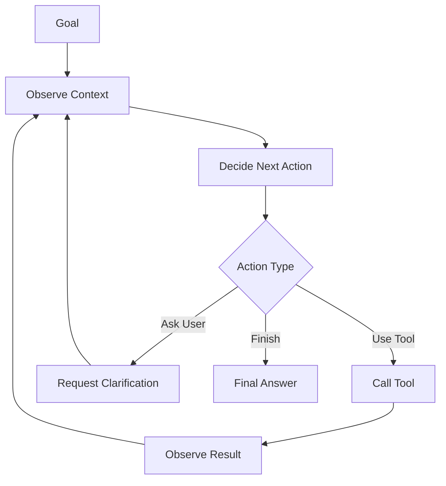

# Agent Loop

The agent loop is the repeated process an agent uses to move from a goal to a result.

A simple model call answers once. An agent loop can inspect state, choose an action, use a tool, observe the result, and continue.

## Why It Matters

The loop is where agentic behavior appears. If the loop is poorly designed, the agent may call tools unnecessarily, repeat itself, lose track of the goal, or never stop.

## Mental Model

An agent loop turns model output into a controlled sequence of actions.

## Basic Steps

1. **Observe** - Read the task, state, memory, and tool results.
2. **Decide** - Choose the next useful action.
3. **Act** - Respond, call a tool, ask a question, or stop.
4. **Inspect** - Check what happened after the action.
5. **Repeat** - Continue until the goal is complete or blocked.

## Stopping Conditions

Stopping is part of intelligence. An agent should stop when:

- The task is complete.
- More action would not improve the answer.
- Required information is missing.
- A safety rule requires human approval.
- The agent hits a step, time, or cost limit.

## Simple Example

User asks: "Summarize this document and list action items."

The agent might:

1. Read the document.
2. Extract key sections.
3. Draft summary.
4. Check whether action items are explicit or inferred.
5. Return final answer with uncertainty noted.

## Common Failure Modes

- No step limit, causing loops.
- No validation after tool calls.
- Acting before enough context is gathered.
- Asking the user questions that could be answered from available context.
- Continuing after the task is already complete.

## Design Tradeoffs

More autonomy can help with open-ended work, but it also increases unpredictability. For many systems, the best design is a workflow with agentic decisions only where flexibility is useful.

## Practical Takeaways

- Every agent needs a clear loop.
- Every loop needs stopping rules.
- Tool results should be inspected before continuing.
- Logs or traces should show each step.
- Good agents know when to stop or ask for help.

## My Notes

The agent loop is the practical heart of agentic AI. When debugging an agent, inspect the loop before blaming the model.
