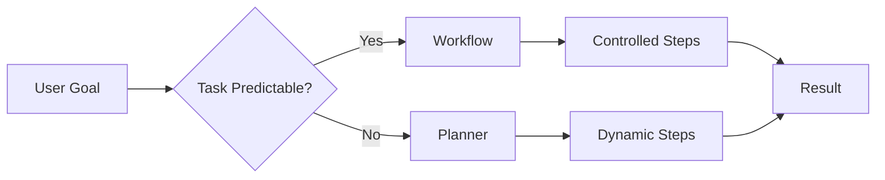

# Planning vs Workflows

Planning lets a model decide steps dynamically. A workflow follows predefined steps created by the developer.

Agentic systems often combine both.

## Why It Matters

Not every task needs dynamic planning. Many reliable systems use fixed workflows with small agentic decisions inside them.

## Mental Model

## Workflow

A workflow is best when the process is known ahead of time.

Examples:

- Intake form processing.
- Document summarization with fixed output sections.
- Data validation.
- Report generation.

## Planning

Planning is useful when the path depends on context.

Examples:

- Investigating an unknown error.
- Researching a broad topic.
- Choosing between multiple tools.
- Breaking down a vague user goal.

## Hybrid Design

A strong production design often looks like this:

- Workflow controls the overall process.
- Agent chooses within bounded steps.
- Tools are restricted and validated.
- Human approval handles risky actions.

## Common Failure Modes

- Using a planner where a simple workflow would be safer.
- Hard-coding a workflow for a task that needs adaptation.
- Letting the model invent steps without constraints.
- Failing to verify whether the plan was followed.

## Practical Takeaways

- Prefer workflows for predictable, high-stakes, or repeatable tasks.
- Use planning when the path is uncertain.
- Bound dynamic planning with clear rules.
- Evaluate plans separately from final answers.
