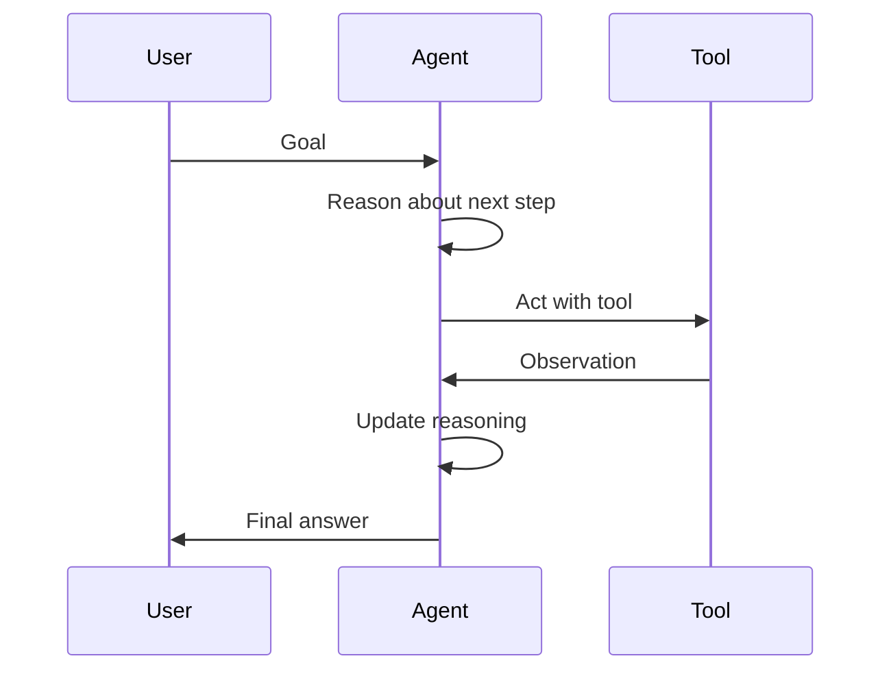

# ReAct Pattern

ReAct means reasoning and acting are interleaved. The agent thinks about what it needs, takes an action, observes the result, and then decides what to do next.

## Why It Matters

ReAct is one of the simplest ways to understand tool-using agents. It makes the agent's behavior easier to inspect because each action is connected to a reason and an observation.

## Mental Model

## How It Works

A ReAct-style loop usually contains:

1. A task or question.
2. A reasoning step about what is needed.
3. An action, often a tool call.
4. An observation from the tool.
5. More reasoning or a final answer.

The important idea is that the agent does not plan everything upfront. It adapts after each observation.

## Simple Example

Question: "What is the total cost of three items priced 12, 19, and 25 dollars?"

The agent reasons that this is arithmetic, calls a calculator tool, observes `56`, and answers.

## Common Failure Modes

- Too many reasoning steps for a simple task.
- Tool calls without enough justification.
- Treating a bad observation as true.
- Looping because the agent never decides it has enough information.
- Exposing private reasoning when only the answer should be shown.

## Design Tradeoffs

ReAct is flexible and easy to debug, but it can be slower than a fixed workflow. It works well when the next action depends on intermediate results.

## Practical Takeaways

- Use ReAct when the agent needs to adapt step by step.
- Keep step limits and stopping rules.
- Log actions and observations.
- Validate tool outputs before trusting them.
