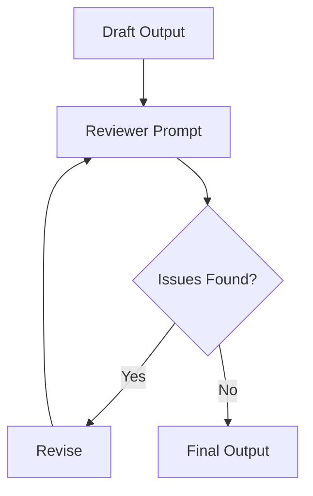

# Reflection

Reflection is when a model reviews, critiques, or revises its own work or another agent's work.

## Why It Matters

Reflection can improve quality, but it can also add cost and create false confidence. It is useful only when the review has a clear target.

## Mental Model

## Useful Reflection Targets

Reflection works best for:

- Checking whether instructions were followed.
- Finding missing sections.
- Reviewing structured output validity.
- Comparing answer against retrieved evidence.
- Identifying uncertainty or assumptions.

## Weak Reflection Targets

Reflection is weaker when asked vague questions like:

- Is this good?
- Try harder.
- Think again.

A reviewer needs criteria.

## Common Failure Modes

- The reviewer invents issues.
- The reviewer approves a wrong answer.
- The system loops through endless revisions.
- Reflection increases cost without improving output.
- The same model repeats the same blind spot.

## Practical Takeaways

- Use reflection with specific checklists.
- Limit the number of revision cycles.
- Prefer evidence-based review for factual tasks.
- Use separate tests for the reviewer itself.
- Do not treat reflection as a substitute for evaluation.
