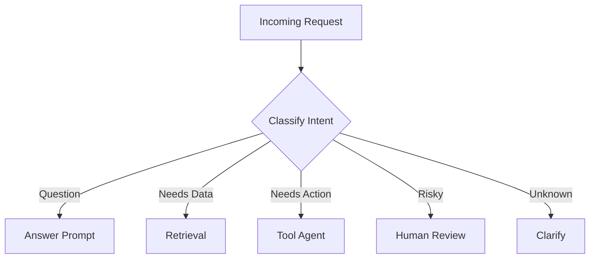

# Routing

Routing is the process of sending a request to the right path: a prompt, tool, workflow, agent, or human.

## Why It Matters

A good router prevents unnecessary complexity. Instead of making one agent handle everything, the system can choose the right specialized path.

## Mental Model

## Routing Targets

A router may choose between:

- Different prompts.
- Different tools.
- Different workflows.
- Different agents.
- Asking the user a clarification question.
- Escalating to a human.

## Routing Methods

Routing can be done by:

- Rules and keywords.
- Classifiers.
- LLM structured output.
- Embedding similarity.
- A mix of deterministic and model-based logic.

## Common Failure Modes

- Routing based on vague categories.
- Sending risky tasks directly to tools.
- Making the router too flexible.
- No fallback path for uncertain classification.
- No evaluation set for routing decisions.

## Practical Takeaways

- Make routing categories explicit.
- Add an `unknown` or `needs_clarification` route.
- Log routing decisions.
- Test routing with confusing examples.
- Prefer deterministic routing when rules are obvious.
