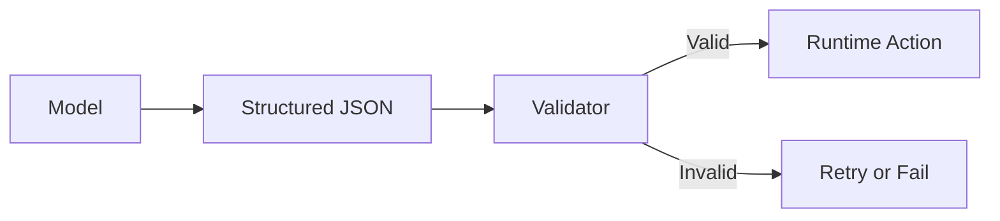

# Structured Outputs

Structured outputs force model responses into a predictable shape, such as JSON matching a schema.

## Why It Matters

Agents often need software to act on model decisions. Free-form text is hard to parse safely. Structured output makes the boundary between model and code clearer.

## Mental Model



## Example

Instead of asking the model to explain what tool it wants, ask for a structured decision:

```json
{
  "action": "lookup_note",
  "input": {
    "query": "agent loop"
  },
  "confidence": "high"
}
```

## Where Structured Outputs Help

- Tool calls.
- Routing decisions.
- Extraction tasks.
- Classification.
- Evaluation results.
- Plans and task lists.

## Common Failure Modes

- Schema is too vague.
- Optional fields are overused.
- The model produces valid JSON with bad reasoning.
- The runtime trusts output without validation.
- The schema does not include uncertainty or fallback states.

## Practical Takeaways

- Use schemas at software boundaries.
- Validate before acting.
- Include explicit failure or clarification options.
- Keep schemas simple and task-specific.
- Remember that valid structure does not guarantee correct content.
