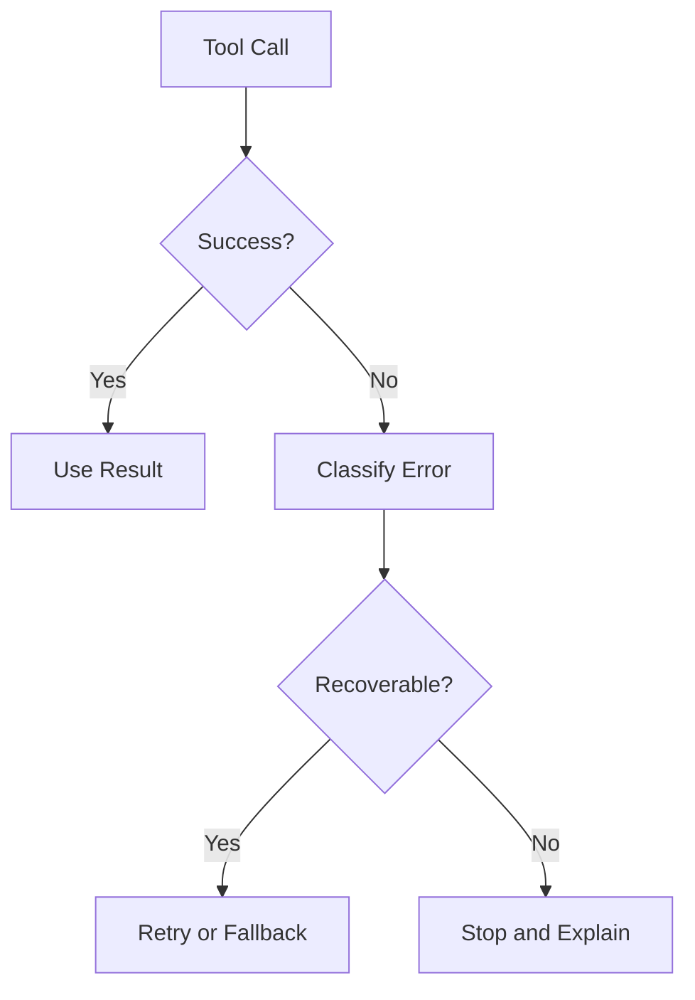

# Error Handling

Error handling defines what an agent does when a tool call, retrieval step, model output, or workflow step fails.

## Why It Matters

Agents operate across multiple steps. One bad result can contaminate the rest of the loop if it is not detected and handled.

## Mental Model

## Error Types

- Invalid input.
- Tool unavailable.
- Permission denied.
- Timeout.
- Empty result.
- Conflicting results.
- Unsafe request.

## Recovery Options

- Retry with corrected input.
- Use a fallback tool.
- Ask the user for missing information.
- Return a partial answer with limitations.
- Stop and explain the blocker.

## Common Failure Modes

- Retrying the same bad call repeatedly.
- Hiding errors from the user.
- Treating empty results as proof that nothing exists.
- Continuing after a safety failure.
- Losing the original task after recovery.

## Practical Takeaways

- Make tool errors structured.
- Limit retries.
- Preserve the original goal during recovery.
- Prefer honest partial answers over invented certainty.
- Log failures for evaluation.
