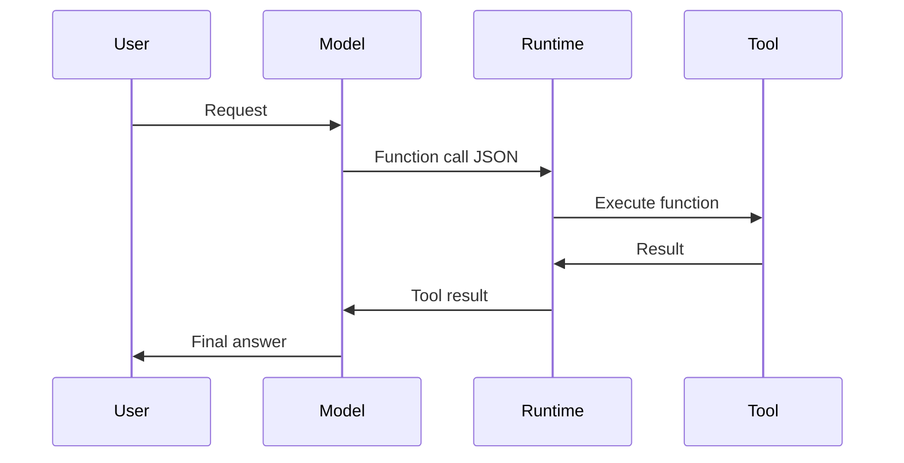

# Function Calling

Function calling is a pattern where a model produces a structured request to call a specific function or tool.

## Why It Matters

Function calling connects natural language goals to deterministic software actions.

## Mental Model



## How It Works

1. The runtime tells the model which tools are available.
2. The model chooses a function and arguments.
3. The runtime validates the arguments.
4. The runtime executes the function.
5. The result is returned to the model.
6. The model continues or answers.

## Example Function

```json
{
  "name": "search_notes",
  "description": "Search local notes by keyword.",
  "parameters": {
    "query": "string"
  }
}
```

## Common Failure Modes

- Wrong function selected.
- Arguments are incomplete or invalid.
- Function result is misunderstood.
- Function has side effects that were not approved.
- Tool descriptions overlap and confuse selection.

## Practical Takeaways

- Give tools clear names and descriptions.
- Validate arguments before execution.
- Return clear errors.
- Log function calls.
- Keep side-effect tools behind approval when needed.
