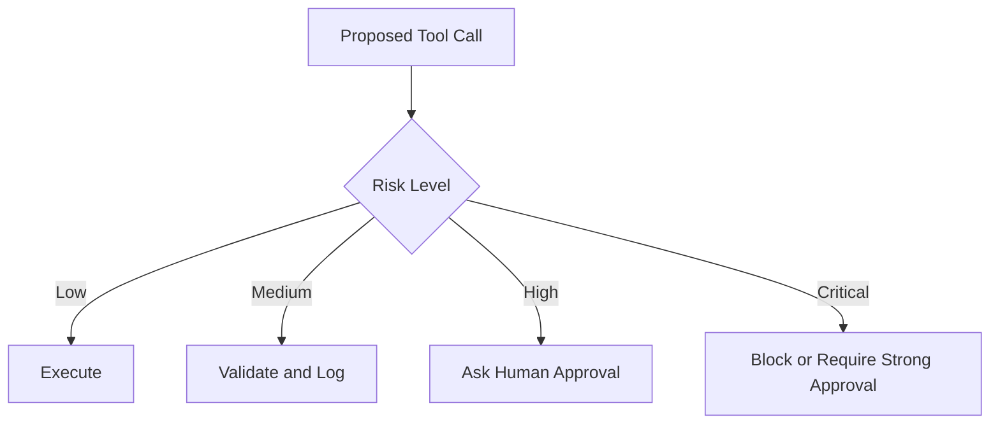

# Tool Safety

Tool safety is the design of boundaries around what an agent can do.

The more powerful the tool, the stronger the safety controls should be.

## Why It Matters

A model response is usually reversible. A tool action may not be. Agents that can send emails, spend money, delete files, or change systems need guardrails.

## Risk Levels

| Risk | Example | Control |
|---|---|---|
| Low | Calculator | Log result. |
| Medium | Search private docs | Restrict access. |
| High | Send email | Require review. |
| Critical | Delete data or spend money | Require explicit approval and audit logs. |

## Safety Flow

## Common Safety Controls

- Allowlists.
- Read-only tools by default.
- Confirmation prompts.
- Rate limits.
- Sandboxed execution.
- Audit logs.
- Secrets isolation.

## Common Failure Modes

- Tool can do more than the agent needs.
- Prompt injection changes tool behavior.
- Human approval is vague.
- Logs do not capture enough detail.
- Secrets are exposed in prompts or outputs.

## Practical Takeaways

- Start with read-only tools.
- Add write tools only when necessary.
- Require approval for irreversible actions.
- Treat retrieved content as untrusted.
- Keep secrets out of model-visible text.
