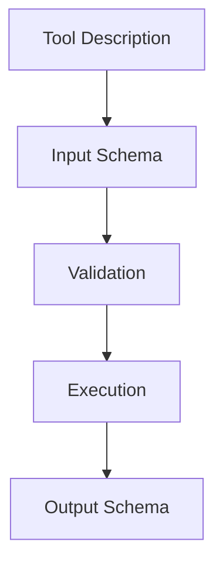

# Tool Schemas

A tool schema defines how an agent can call a tool.

It describes the tool name, purpose, input fields, output shape, and constraints.

## Why It Matters

Schemas are the contract between model reasoning and program execution. Good schemas reduce ambiguity and make validation possible.

## Mental Model



## Schema Design Principles

- Use specific tool names.
- Make required fields truly required.
- Use enums for limited choices.
- Include descriptions for fields.
- Avoid giant catch-all tools.
- Return structured output when possible.

## Example

```json
{
  "tool": "create_calendar_event",
  "input": {
    "title": "Project review",
    "date": "2026-11-20",
    "start_time": "14:00",
    "duration_minutes": 30
  }
}
```

## Common Failure Modes

- Fields are too broad, such as `data` or `payload`.
- Tool names sound similar.
- Optional fields are needed in practice.
- The schema omits risk level.
- Output does not say whether execution succeeded.

## Practical Takeaways

- Tool schemas should be boring and precise.
- Add validation before execution.
- Make success and failure easy to distinguish.
- Design outputs for the next agent step.
