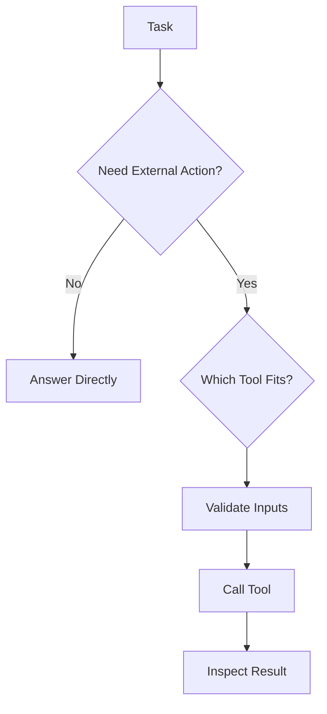

# Tool Selection

Tool selection is how an agent decides which tool, if any, to call next.

## Why It Matters

Tool use is powerful but not always needed. A good agent knows when to use a tool, which tool to use, and when to answer without tools.

## Mental Model

## Selection Criteria

An agent should use a tool when the task requires:

- Current information.
- Private documents.
- Calculation.
- File or database access.
- External actions.
- Verification.

It should avoid tools when the answer is already available from context and no verification is needed.

## Common Failure Modes

- Calling tools for simple reasoning.
- Guessing instead of retrieving.
- Choosing a tool with overlapping purpose.
- Repeating the same failed tool call.
- Ignoring tool errors.

## Practical Takeaways

- Tool descriptions should state when to use and when not to use the tool.
- Add fallback behavior for uncertainty.
- Track failed tool calls.
- Evaluate tool choice with examples.
