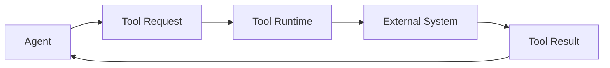

# What Is a Tool?

A tool is an action an agent can request outside the language model.

Tools let agents calculate, search, retrieve documents, call APIs, inspect files, update systems, or ask for human approval.

## Why It Matters

Models generate text. Tools let agent systems interact with the world. Tool design is where agentic AI becomes practical.

## Mental Model

## Examples

- Calculator.
- Web search.
- File reader.
- Database query.
- Calendar API.
- Email draft creator.
- Human approval request.

## Tool Contract

A useful tool has:

- A clear name.
- A specific purpose.
- Input schema.
- Output schema.
- Error behavior.
- Safety rules.

## Common Failure Modes

- Tool does too many unrelated things.
- Tool name or description is vague.
- Inputs are not validated.
- Output is hard for the agent to interpret.
- Tool can perform dangerous actions without approval.

## Practical Takeaways

- Tools should be narrow and explicit.
- Tool results should be structured when possible.
- Risky tools need permission boundaries.
- Agents should inspect tool results before continuing.
