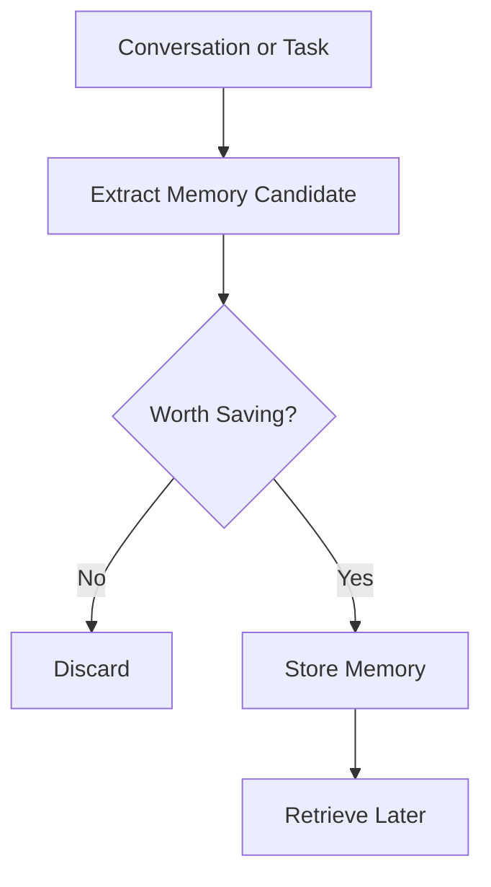

# Agent Memory

Agent memory is stored information that an agent can use across steps or sessions.

Memory is not the same as RAG, but they often overlap. RAG retrieves external knowledge. Memory stores information from prior interactions, decisions, preferences, or task state.

## Why It Matters

Agents often need continuity. Memory helps them avoid starting from zero every time.

## Types of Memory

| Type | Meaning | Example |
|---|---|---|
| Short-term | State inside the current task. | Steps already completed. |
| Long-term | Information saved across sessions. | User preferences. |
| Episodic | Records of past events. | Previous agent runs. |
| Semantic | Facts or knowledge. | Project architecture notes. |
| Procedural | How to do something. | Preferred workflow. |

## Memory Flow

## Memory Design Questions

- What should be remembered?
- Who can update memory?
- How is memory corrected?
- How long should memory last?
- Should memory be visible to the user?

## Common Failure Modes

- Saving too much irrelevant information.
- Saving incorrect information.
- Using stale memory.
- Making hidden assumptions from memory.
- Mixing private data into unrelated tasks.

## Practical Takeaways

- Memory needs write rules and delete rules.
- Treat memory as data, not magic.
- Show or explain important memory when it affects behavior.
- Evaluate whether memory improves task success.
