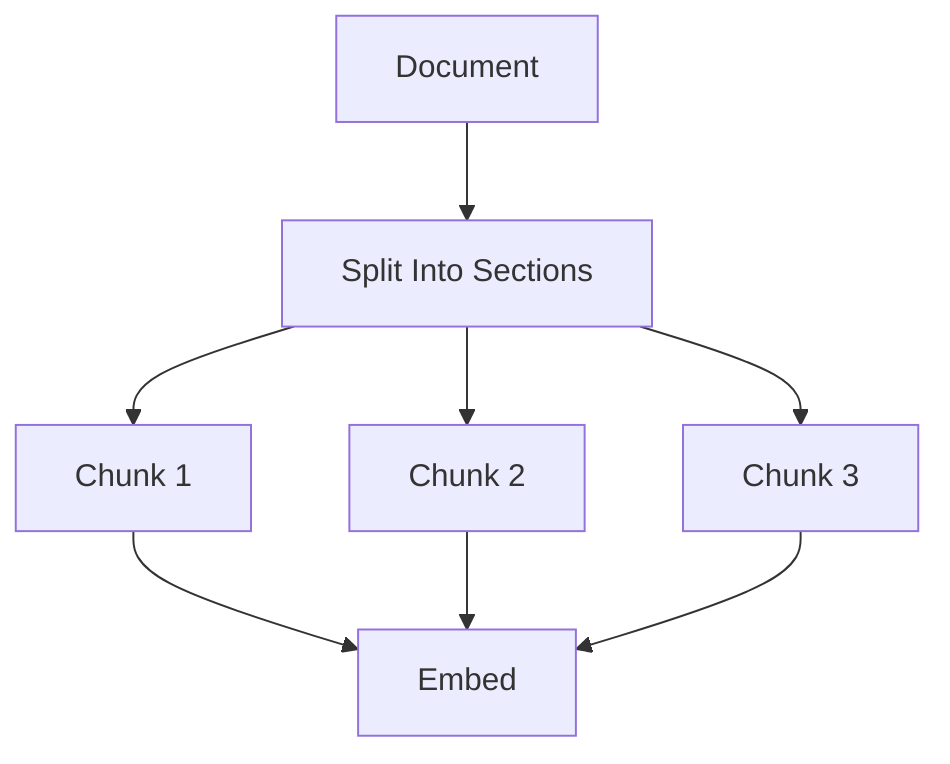

# Chunking

Chunking is the process of splitting documents into smaller pieces before retrieval.

## Why It Matters

RAG systems retrieve chunks, not whole documents. If the chunks are poorly designed, the agent may never see the right context.

## Mental Model

## Chunking Strategies

- Fixed-size chunks.
- Paragraph-based chunks.
- Heading-based chunks.
- Semantic chunks.
- Sliding windows with overlap.

## Tradeoffs

Small chunks are precise but may lack context.

Large chunks preserve context but may retrieve irrelevant material.

Overlap helps preserve continuity, but too much overlap increases storage and duplication.

## Common Failure Modes

- Splitting in the middle of important context.
- Chunks are too small to answer questions.
- Chunks are too large and noisy.
- Tables and code blocks are broken incorrectly.
- Metadata such as title or source is lost.

## Practical Takeaways

- Preserve headings and source metadata.
- Test chunking with real questions.
- Inspect retrieved chunks, not just final answers.
- Tune chunk size based on document type.
- Treat chunking as a design choice, not preprocessing trivia.
