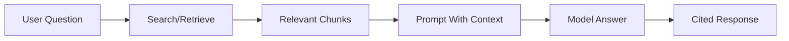

# RAG Basics

RAG stands for retrieval-augmented generation. It means the system retrieves relevant information before asking the model to answer.

## Why It Matters

Models do not automatically know private files, recent data, or your project's internal knowledge. RAG gives the model grounded context from external sources.

## Mental Model

## Basic Pipeline

1. Collect documents.
2. Split them into chunks.
3. Convert chunks into embeddings.
4. Store embeddings in a vector database or index.
5. Search for relevant chunks when a question arrives.
6. Add retrieved chunks to the prompt.
7. Generate an answer grounded in the retrieved context.

## When RAG Helps

- Answering questions over private documents.
- Using changing information.
- Reducing unsupported answers.
- Giving sources or citations.
- Building knowledge assistants.

## Common Failure Modes

- Bad chunking hides the answer.
- Retrieval returns irrelevant context.
- The model ignores retrieved context.
- The answer is correct but unsupported by sources.
- The system retrieves too much context and confuses the model.

## Practical Takeaways

- RAG quality depends heavily on retrieval quality.
- Chunking strategy matters.
- Always inspect retrieved context during debugging.
- Evaluate retrieval and generation separately.
- Prefer citing retrieved sources when possible.
