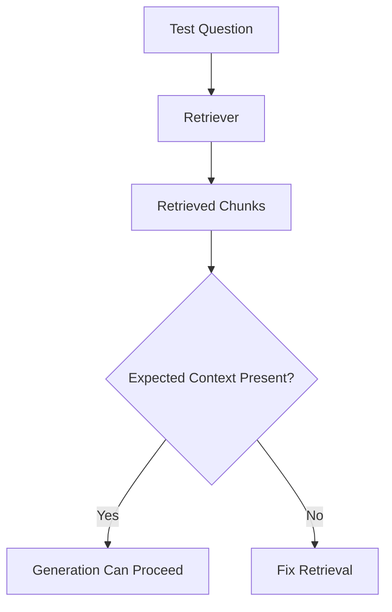

# Retrieval Evaluation

Retrieval evaluation checks whether a RAG system retrieves the right context before generation.

## Why It Matters

If retrieval fails, the final answer is likely to fail. A fluent answer can hide a bad retrieval step.

## Mental Model

## What To Measure

- Did the expected chunk appear?
- How high was it ranked?
- Was irrelevant context included?
- Did metadata filters work?
- Did the answer cite the right source?

## Test Set

A retrieval test set should include:

- Questions with known source chunks.
- Paraphrased questions.
- Questions with exact keywords.
- Questions with no answer in the documents.
- Ambiguous questions.

## Common Failure Modes

- Testing only final answers.
- No expected source defined.
- Ignoring no-answer cases.
- Passing too many chunks to compensate for weak retrieval.
- Not testing after document changes.

## Practical Takeaways

- Evaluate retrieval before generation.
- Keep a small set of known questions.
- Inspect failed retrievals manually.
- Tune chunking, metadata, and search together.
