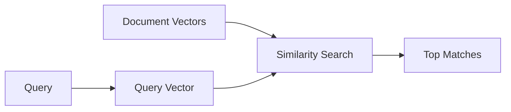

# Vector Search

Vector search finds items with similar embeddings.

In RAG systems, it is often used to retrieve document chunks that are semantically related to a user question.

## Why It Matters

Vector search lets agents find relevant context even when the wording differs from the documents.

## Mental Model

## Retrieval Flow

1. Embed the user query.
2. Compare it against stored document embeddings.
3. Rank chunks by similarity.
4. Return the top matches.
5. Optionally rerank or filter results.

## Useful Additions

- Metadata filters.
- Hybrid keyword plus vector search.
- Reranking models.
- Score thresholds.
- Source citations.

## Common Failure Modes

- Top result is semantically similar but not answer-bearing.
- Results are stale.
- Important metadata is not available for filtering.
- Too many results are passed into the model.
- Similarity score is treated as confidence in truth.

## Practical Takeaways

- Vector search finds likely context, not guaranteed answers.
- Use metadata filters for domain, date, or source.
- Rerank when precision matters.
- Evaluate retrieval with known questions and expected chunks.
