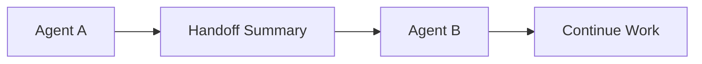

# Handoffs

A handoff is when one agent passes work, context, or responsibility to another agent or human.

## Why It Matters

Many multi-agent systems fail because handoffs lose context. A good handoff makes the next actor immediately useful.

## Handoff Contents

A strong handoff includes:

- Original goal.
- Current status.
- Completed steps.
- Key findings.
- Open questions.
- Constraints or safety rules.
- Expected next action.

## Handoff Flow

## Common Failure Modes

- Missing original goal.
- Too much irrelevant history.
- No clear next action.
- Hidden assumptions.
- Losing tool results or sources.

## Practical Takeaways

- Handoffs should be structured.
- Include only useful context.
- Make responsibility clear.
- Preserve sources and tool outputs.
- Use handoff templates for repeated workflows.
