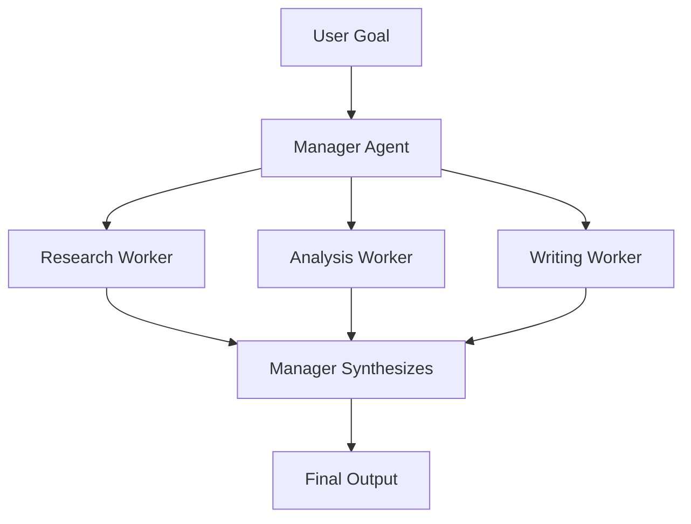

# Manager-Worker Pattern

The manager-worker pattern uses one coordinating agent to delegate tasks to worker agents.

## Why It Matters

This pattern helps when a task has multiple specialized subtasks that need coordination.

## Mental Model

## Manager Responsibilities

- Understand the overall goal.
- Split work into subtasks.
- Assign subtasks to workers.
- Merge results.
- Resolve conflicts.
- Decide when the task is complete.

## Worker Responsibilities

- Complete a narrow task.
- Return structured results.
- State uncertainty and limitations.
- Avoid taking over the manager's job.

## Common Failure Modes

- Manager delegates vague tasks.
- Workers return incompatible formats.
- Manager blindly merges conflicting outputs.
- Too many workers create noise.
- No clear final decision rule.

## Practical Takeaways

- Give each worker a narrow role.
- Use structured worker outputs.
- Make the manager responsible for synthesis.
- Evaluate both worker quality and final synthesis.
