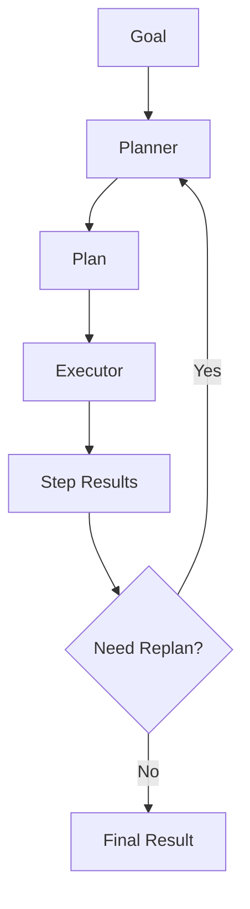

# Planner-Executor Pattern

The planner-executor pattern separates deciding what should happen from doing the work.

## Why It Matters

Planning and execution require different behaviors. A planner should create a clear path. An executor should carry out steps carefully and report results.

## Mental Model

## Planner Role

- Break down the goal.
- Order steps.
- Identify dependencies.
- Decide what tools or workers may be needed.
- Define success criteria.

## Executor Role

- Follow the plan.
- Use tools.
- Report step results.
- Stop on blockers.
- Avoid inventing a new plan unless allowed.

## Common Failure Modes

- Planner creates unrealistic steps.
- Executor follows a bad plan blindly.
- No replan condition.
- Plan is too detailed and brittle.
- Plan is too vague to execute.

## Practical Takeaways

- Plans should be actionable, not decorative.
- Executors need permission rules.
- Replanning should be explicit.
- Logs should show planned vs actual steps.
