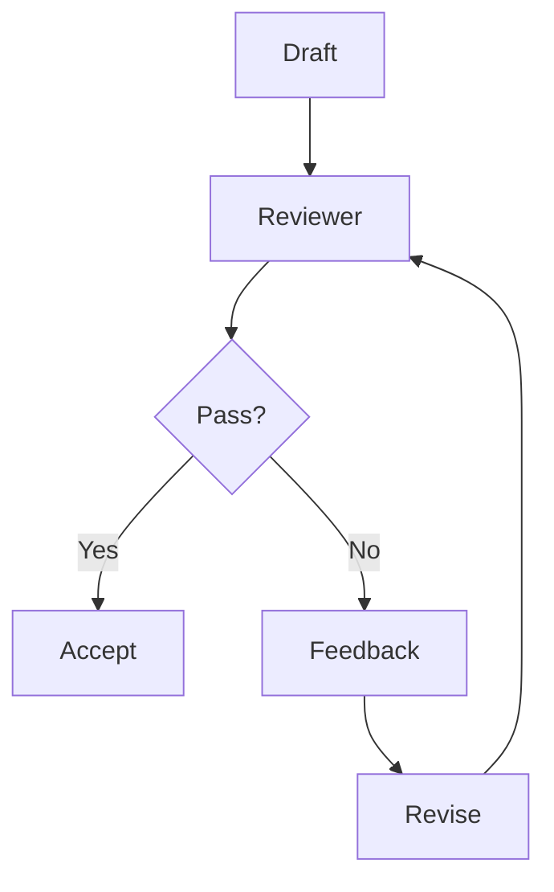

# Reviewer Agents

A reviewer agent checks the work of another agent against specific criteria.

## Why It Matters

Reviewers can improve quality when they are given concrete standards. They are especially useful for checking structure, evidence, safety, and completeness.

## Mental Model

## Good Review Criteria

- Did the output answer the question?
- Is the answer supported by evidence?
- Are assumptions stated?
- Is the format correct?
- Are safety rules followed?
- Are important edge cases missing?

## Common Failure Modes

- Reviewer gives generic feedback.
- Reviewer invents problems.
- Reviewer approves unsupported claims.
- Revision loop never ends.
- Reviewer and writer share the same blind spots.

## Practical Takeaways

- Give reviewers checklists.
- Limit revision rounds.
- Ask for specific findings, not vibes.
- Use reviewers for high-value checks, not every tiny output.
