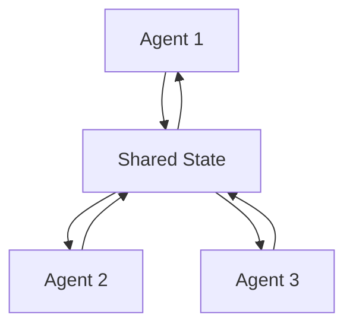

# Shared State

Shared state is information multiple agents can read or update during a workflow.

## Why It Matters

Agents need coordination. Without shared state, they may duplicate work, lose context, or overwrite each other's assumptions.

## Mental Model

## What Shared State Can Include

- Task status.
- Current plan.
- Completed steps.
- Tool results.
- Retrieved sources.
- Decisions and rationale.
- Open questions.

## Design Questions

- Who can write to state?
- What updates are allowed?
- Is there a single source of truth?
- How are conflicts resolved?
- Is state visible to humans?

## Common Failure Modes

- State becomes messy and untrusted.
- Agents overwrite each other.
- State includes stale information.
- No audit trail exists.
- Sensitive data is shared too widely.

## Practical Takeaways

- Keep shared state structured.
- Track who wrote what and when.
- Separate facts from hypotheses.
- Include status and next action.
- Clean up stale state when workflows end.
