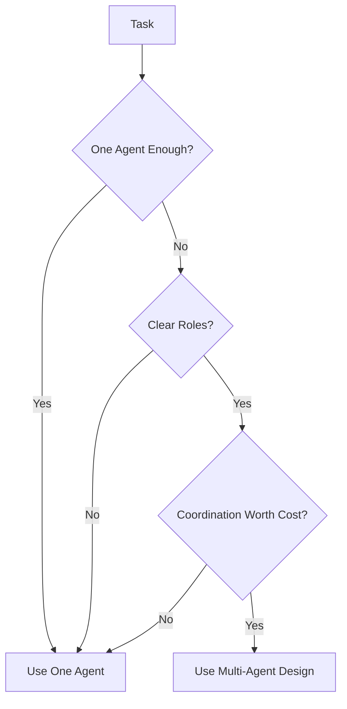

# When To Use Multiple Agents

Multiple agents should be used when separate roles improve the system, not because it sounds advanced.

## Why It Matters

Multi-agent systems can add specialization and review. They can also add cost, latency, confusion, and harder debugging.

## Use Multiple Agents When

- Different skills are genuinely needed.
- Work can happen in parallel.
- Review or critique improves quality.
- A manager needs to delegate specialized subtasks.
- Separate context windows reduce confusion.

## Avoid Multiple Agents When

- One clear workflow is enough.
- The roles are vague.
- Agents mostly repeat each other.
- Coordination costs more than it helps.
- The task needs deterministic reliability.

## Decision Flow

## Common Failure Modes

- Adding agents without clear responsibilities.
- No shared state design.
- Handoffs lose important context.
- Agents disagree without a resolution rule.
- Review agents give vague feedback.

## Practical Takeaways

- Start with one agent.
- Add agents only for clear roles.
- Define ownership and handoffs.
- Log each agent's contribution.
- Evaluate whether multiple agents actually improve outcomes.
