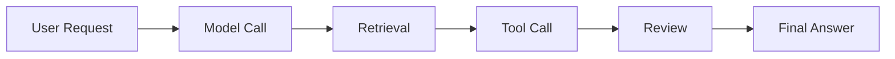

# Cost and Latency

Cost and latency are practical constraints in agentic systems.

Agents can become expensive or slow because they may use multiple model calls, retrieval steps, tool calls, and review loops.

## Why It Matters

A system that works but is too slow or too expensive may not be usable.

## Cost Drivers

- Number of model calls.
- Size of prompts and retrieved context.
- Model choice.
- Tool calls.
- Retry loops.
- Multi-agent coordination.
- Reflection or review steps.

## Latency Flow

Each step adds time.

## Optimization Ideas

- Use smaller models for simple routing or extraction.
- Cache repeated retrieval or tool results.
- Limit context to relevant information.
- Avoid unnecessary reflection.
- Run independent subtasks in parallel.
- Set step and retry limits.

## Common Failure Modes

- Passing too much context to every call.
- Using the strongest model for every step.
- Letting agents loop without limits.
- Adding multi-agent review where it does not improve quality.
- Ignoring latency until late.

## Practical Takeaways

- Measure cost and latency early.
- Optimize the workflow, not just the model.
- Use expensive steps only where they add value.
- Include step limits in agent design.
