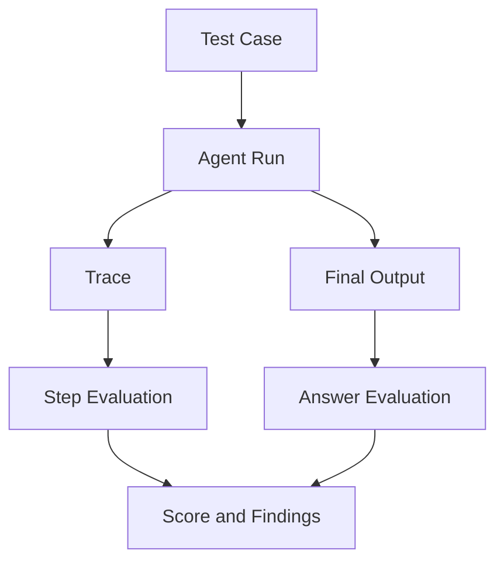

# Evaluating Agents

Evaluating agents means testing whether a multi-step system completes tasks correctly, safely, and consistently.

## Why It Matters

A demo can work once and still be unreliable. Evaluation helps show whether the agent works across realistic cases, edge cases, and failure cases.

## Mental Model

## What To Evaluate

- Did the agent understand the goal?
- Did it choose the right tools?
- Did it use retrieved context correctly?
- Did it stop at the right time?
- Did it follow safety rules?
- Was the final answer useful and supported?

## Evaluation Types

- Unit tests for tools.
- Routing tests.
- Retrieval tests.
- End-to-end task tests.
- Human review.
- Automated judge review with clear rubrics.

## Common Failure Modes

- Only testing happy paths.
- Judging final answers without inspecting steps.
- No regression tests after prompt changes.
- Vague rubrics.
- Ignoring cost and latency.

## Practical Takeaways

- Evaluate steps and final outputs.
- Keep a small golden test set.
- Add failure cases early.
- Review traces when behavior changes.
- Treat evals as part of the product, not an afterthought.
