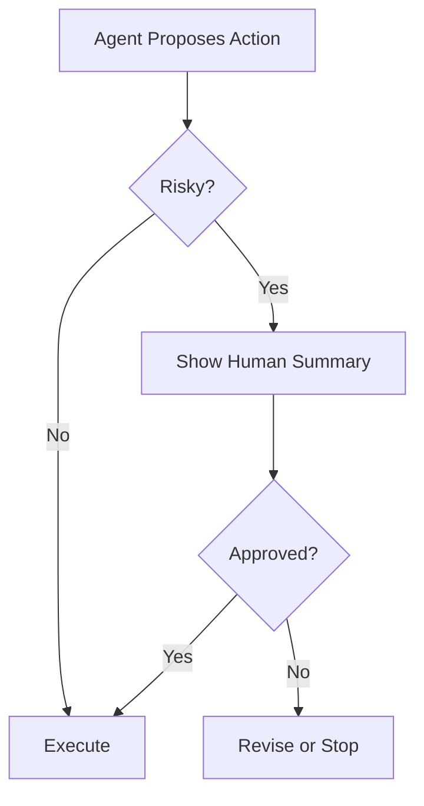

# Human in the Loop

Human-in-the-loop design adds human review, approval, or correction to an agentic system.

## Why It Matters

Some actions are too risky for full automation. Human review can improve safety, quality, and trust.

## When Humans Should Be Involved

- Irreversible actions.
- Financial transactions.
- Sending external messages.
- Changing production systems.
- Handling sensitive data.
- Low-confidence decisions.
- Policy or compliance decisions.

## Approval Flow

## Good Approval Requests Include

- What the agent wants to do.
- Why it wants to do it.
- What data or tool will be used.
- Expected result.
- Risks or uncertainty.
- Clear approve/reject options.

## Common Failure Modes

- Approval request is too vague.
- Human is asked too often and starts rubber-stamping.
- Agent hides uncertainty.
- No record of approval.
- Human cannot edit the proposed action.

## Practical Takeaways

- Use human approval for meaningful risk.
- Make approval requests specific.
- Log decisions.
- Let humans correct, not just approve or reject.
- Avoid asking for approval on trivial actions.
