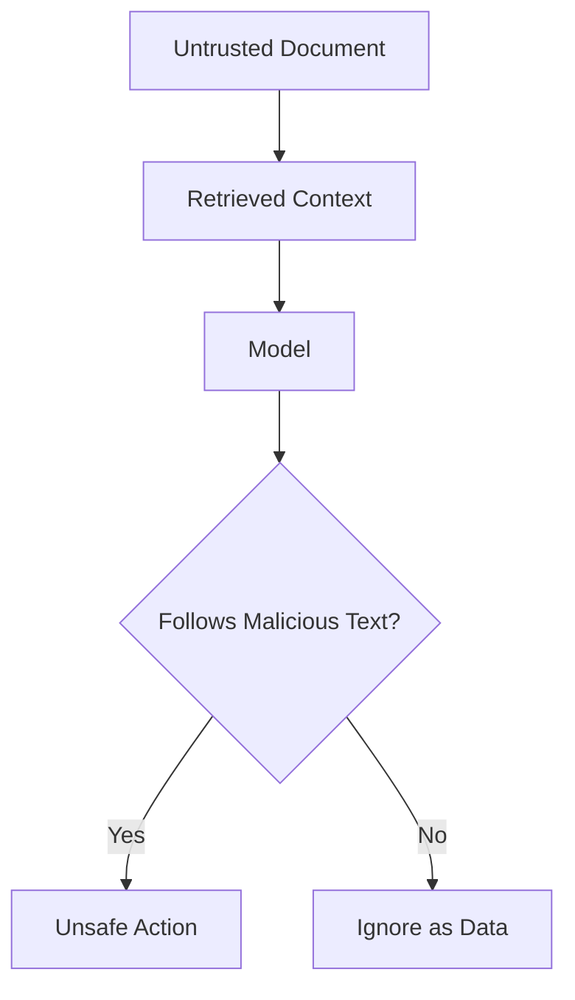

# Security Risks

Agentic systems introduce security risks because models can process untrusted text and call tools.

## Why It Matters

An agent may read instructions from users, documents, websites, emails, or tool outputs. Some of that content can be malicious or misleading.

## Key Risks

| Risk | Meaning |
|---|---|
| Prompt injection | Untrusted text tries to override instructions. |
| Data exfiltration | Sensitive data is exposed through output or tools. |
| Tool misuse | Agent calls a tool in an unsafe way. |
| Over-permission | Tool access is broader than needed. |
| Hidden instructions | Retrieved content contains malicious commands. |

## Prompt Injection Flow

## Safety Practices

- Treat retrieved content as data, not instructions.
- Keep system instructions separate from external content.
- Use least-privilege tools.
- Require approval for risky actions.
- Validate tool inputs.
- Log security-relevant events.
- Avoid exposing secrets to the model.

## Common Failure Modes

- Agent trusts web or document text as instructions.
- Tool has unnecessary write permissions.
- Secrets are included in prompts.
- Human approval prompt hides important details.
- Security is added after the system is already complex.

## Practical Takeaways

- Design for untrusted input from the beginning.
- Separate instructions from data.
- Restrict tools by default.
- Make risky actions explicit and reviewable.
