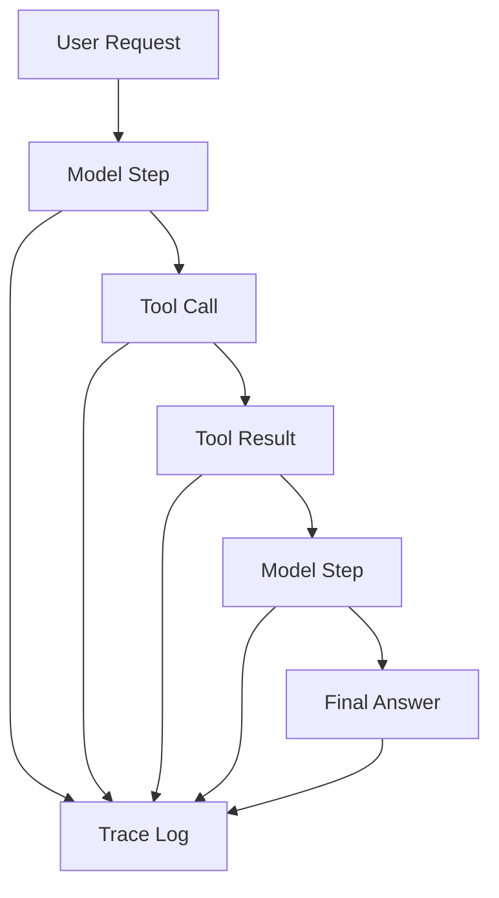

# Tracing and Debugging

Tracing records what happened during an agent run.

A trace shows the steps, model decisions, tool calls, observations, and final output.

## Why It Matters

Without traces, agent failures are hard to understand. The final answer may be wrong because of routing, retrieval, tool output, prompt design, or model behavior.

## Mental Model

## What To Trace

- User input.
- Selected route or workflow.
- Model outputs used for decisions.
- Tool calls and arguments.
- Tool results.
- Retrieved chunks.
- Errors and retries.
- Final answer.
- Cost and latency when available.

## Debugging Questions

- Did the agent understand the goal?
- Did it have the right context?
- Did retrieval return useful information?
- Did the tool call succeed?
- Did the model misread the tool result?
- Did stopping happen too early or too late?

## Common Failure Modes

- Logs omit tool inputs.
- Sensitive data is logged carelessly.
- Trace is too noisy to inspect.
- No correlation between steps.
- Errors are swallowed instead of recorded.

## Practical Takeaways

- Trace enough to explain behavior.
- Protect sensitive data in logs.
- Make traces easy to review.
- Use traces when improving prompts and tools.
