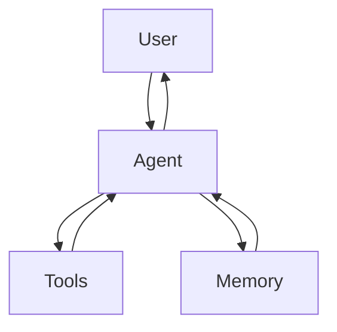

# Future Project Note Template

Use this later when projects are added.

```markdown
# Project Name

Short explanation of what the agent does.

## Problem

What problem is this solving?

## Agent Boundary

What can the agent decide, and what is fixed?

## Architecture



## Tools

List tools, schemas, and risks.

## Memory or Retrieval

Explain whether the project uses RAG, memory, or neither.

## Evaluation

List test cases and expected behavior.

## Known Limitations

Be honest about where the project is weak.

## Reflection

What did this project teach?
```
