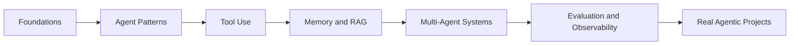
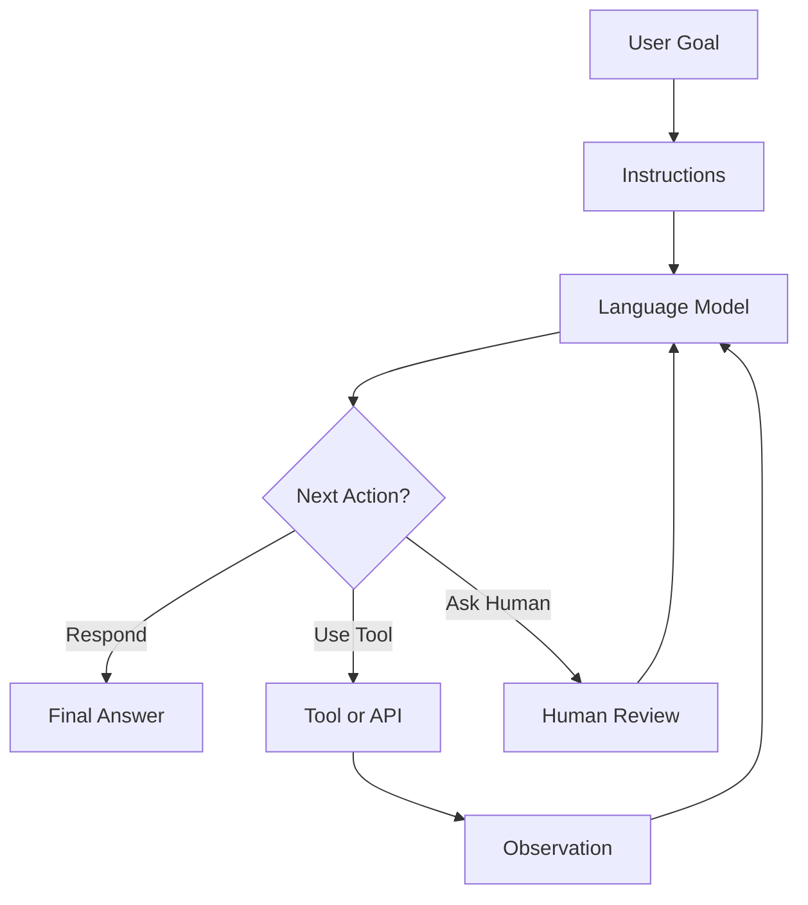

# Agentic AI Learning Map

This map shows how the notes build toward real agentic AI projects.

The purpose is to avoid jumping straight into frameworks before the core ideas are clear. A good agentic project needs more than a model call. It needs goals, context, tools, state, evaluation, and safety.

## Big Picture

## What Each Stage Gives You

| Stage | Main Skill | Why It Matters |
|---|---|---|
| Foundations | Understand the pieces of an agent. | Prevents vague thinking and buzzword-driven design. |
| Agent Patterns | Structure model behavior. | Helps agents make decisions in repeatable ways. |
| Tool Use | Let agents act outside text. | Connects agents to APIs, files, data, and workflows. |
| Memory and RAG | Give agents external knowledge. | Makes agents useful on private or changing information. |
| Multi-Agent Systems | Coordinate specialized roles. | Helps with complex work when clear role separation adds value. |
| Evaluation | Measure reliability. | Turns demos into systems you can trust. |

## Core Mental Model

An agent is not just the model. It is the full loop around the model.

## Learning Rule

For each topic, learn these four things:

1. The definition.
2. The mechanism.
3. The failure modes.
4. The design tradeoffs.

If a note only defines a term but does not explain how it fails, it is not complete yet.

## Project Readiness

Before starting a real project, the notes should make you comfortable answering:

- What is the goal of the agent?
- What should the agent be allowed to do?
- What tools does it need?
- What context does it need?
- How will it know when to stop?
- How will failures be detected?
- What should require human approval?
