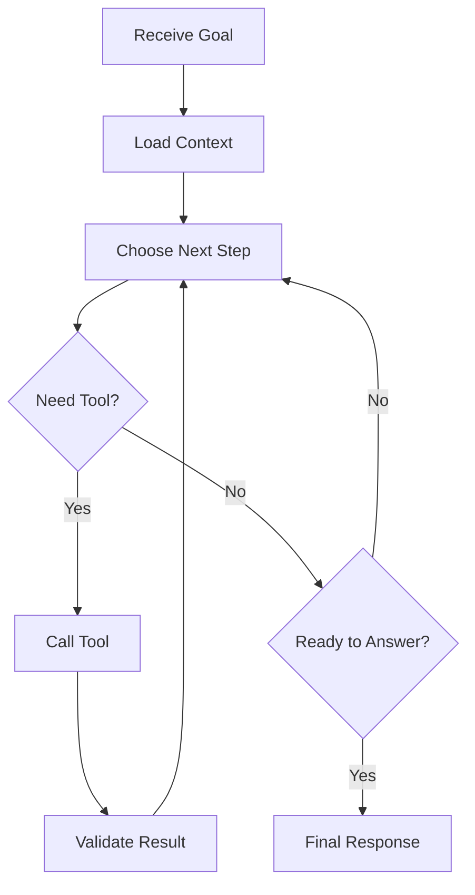

# Project Readiness Checklist

Use this checklist before starting an agentic AI project.

The goal is to make sure the project has a clear design before code starts.

## 1. Problem Definition

- What user problem is this agent solving?
- Why does the task need an agent instead of a simple script or workflow?
- What does success look like?
- What should the agent refuse or avoid?

## 2. Agent Boundary

- What can the agent decide on its own?
- What must be predefined by the developer?
- What requires human approval?
- What is outside the agent's responsibility?

## 3. Inputs and Context

- What information does the user provide?
- What system instructions shape behavior?
- What files, documents, APIs, or databases does the agent need?
- What context must be preserved across steps?

## 4. Tools

- Which tools does the agent need?
- What are the inputs and outputs of each tool?
- What can go wrong when each tool is called?
- Are any tools risky, expensive, or irreversible?

## 5. Memory and Retrieval

- Does the agent need knowledge outside the prompt?
- Does it need short-term memory, long-term memory, or both?
- What should be embedded or indexed?
- How will retrieval quality be tested?

## 6. Control Flow

- What is the normal path?
- What are the fallback paths?
- What stops infinite loops?
- What happens when the agent is uncertain?

## 7. Evaluation

- What examples prove the agent works?
- What examples prove it handles failure?
- What logs or traces will be reviewed?
- What metrics matter: accuracy, latency, cost, safety, or user satisfaction?

## 8. Public Portfolio Quality

For a project that demonstrates expertise, include:

- Clear README.
- Architecture diagram.
- Setup steps.
- Example runs.
- Known limitations.
- Evaluation notes.
- Reflection on what was learned.
